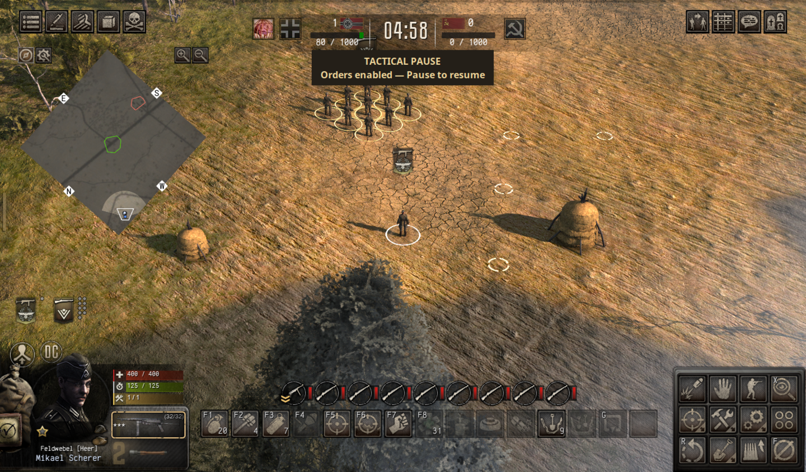
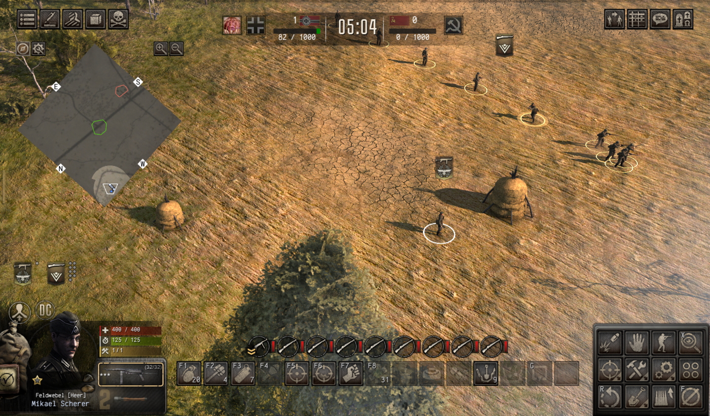

# Gates of Hell: tactical pause

Experimental tactical pause for **solo Dynamic Conquest** in *Call to Arms – Gates of Hell: Ostfront*: freeze the battle, select different units, give native orders, then resume. This is a real pause, not slow motion. Ordinary single-player campaign active pause is left intact.

**Version 0.5.0 · native pause tested with game 1.067.0, Steam build 25492057, on one Linux/Proton system.** Windows setup is documented but runtime-unverified; no Windows behavior is claimed. Steam setup is manual. Multiplayer and co-op are unsupported.

## Screenshots

**Paused Conquest:** a selected squad and native waypoint markers, with the tactical-pause indicator visible.



**After resume:** the officer and squad execute their separate orders.



## What was tested

- Selecting an officer and a separate squad while frozen, assigning different destinations, and observing both execute their orders on resume.
- Camera movement/zoom, order replacement, cancellation and native Shift-waypoint execution.
- Pausing with an MP40 trigger held: ammunition consumption stopped and resumed with the simulation.
- Single-player `Cold Supper`: native paused selection/orders and subsequent execution.
- Conquest retreat while paused: cancelling preserves pause; confirming resumes the native server so saving and mission completion finish. The saved operation reloaded successfully.
- Cold GOHSE loading, managed-patch rollback and normal game/launcher shutdown.

These checks are not coverage of every action, weapon, mission or mod combination. Manual save/load **inside** an actively paused mission is not established. Back up your saves and use an isolated copy.

## Read before running

This uses **GOHSE, an external native-code loader, and native memory patches**. Lua is not a sandbox: review this source and the loader, and do not treat the separate Proton prefix as protection from malicious code. No game executable or dependency DLL is distributed here.

The marker is an explicit opt-in, not a safety boundary. While present, it activates this mod in **every battle** on the matching client build, including human multiplayer. Multiplayer/co-op are unsupported and must not be joined while the marker is active. Do not disable anti-cheat, DRM or server checks to make it run.

This is distributed outside Steam Workshop. Read the developers' [Workshop policy announcement](https://store.steampowered.com/news/app/400750/view/715668461242548712), particularly before redistributing native-loader-based mods.

## Requirements and current portability limits

- Python **3.9+** and an owned installation of game **1.067.0**, client SHA-256 `4b6a807ad867c4f6eb1019376224d74fa3a6ac048355739ab0b76d73c7c0a267`.
- **[GOHSE 0.1.1](https://github.com/nature2468/gohse/releases/tag/v0.1.1)**. The tested `version.dll` SHA-256 is `8664a225b0615992834f7408d58ff1ae5df1c9e9eff8811d8e7c0f44f4d1c426`. Obtain it from the loader's own release, not an unsolicited DLL mirror. Read its installation notes and dependency notices.
- Linux/Proton runtime behavior has been verified on one system. Windows native installation is documented but runtime-unverified until tested on a real Windows system. Steam Deck is out of scope.

Unsupported executable hashes fail closed. Do not remove the checks or guess new offsets when the game updates.

## Installation and AI-agent help

Give your agent **[AGENT_INSTALL.md](AGENT_INSTALL.md)**. Review the actual installation and obtain human approval before installing GOHSE, project files or launching gameplay.

1. **Close the game and back up your ordinary saves.** Let normal Steam Cloud synchronization finish. Steam Offline Mode and Cloud OFF for this game are optional recommendations, not requirements.
2. Obtain the release ZIP or source repository. Install GOHSE's matching `version.dll` beside `call_to_arms.exe` (under `binaries/x64`). **Back up any existing `version.dll`; do not overwrite an unknown proxy or another loader.**
3. Extract the `tactical_pause` folder into `<game>/gohse/mods/`, producing `<game>/gohse/mods/tactical_pause/`. Do not copy private data or the whole research workspace.
4. From the extracted folder, run `python3 enable.py`. It verifies the client SHA-256 and creates `enable-tactical-pause` beside the mod files with exactly:

   ```text
   4b6a807ad867c4f6eb1019376224d74fa3a6ac048355739ab0b76d73c7c0a267
   ```

   Alternatively create that file manually with exactly that hash and a trailing newline. The marker remains active for every matching-build battle until removed.
5. **Windows native:** start Gates of Hell via Steam; no DLL override is needed. This setup is documented, but Windows runtime behavior remains unverified until a real Windows test.
6. **Linux/Proton:** add this one-time Steam launch option, then start via Steam:

   ```text
   WINEDLLOVERRIDES=version=n,b %command%
   ```

   The isolated developer launcher `run_offline.py` remains available for testing; it is not the normal user activation path. Steam Offline Mode and Cloud OFF remain optional recommendations.
7. Test only in a disposable single-player campaign or solo Conquest operation. Do not join multiplayer/co-op while the marker is present.

To disable activation, remove the marker file. To stop using the mod, close the game and move `gohse/mods/tactical_pause` outside the GOHSE mod directory.

Use the game's existing **Pause** binding to freeze/resume. Click or box-select units while paused and issue normal orders. With the tested profile, right-click moves, Shift + right-click appends waypoints, and **F** cancels an order. Your own bindings may differ.


A passive **TACTICAL PAUSE — Orders enabled** indicator appears for paused Conquest while the game is foreground. Campaign missions keep their native indicator. No custom order recorder or replay queue is added.

Quit through the game's menu for normal saving. Steam Offline Mode and Cloud OFF are optional recommendations; neither is managed by the mod or its helper.

Progress remains in the normal game profile. The isolated developer launcher remains available for testing and uses its own private data; it is not required for the Steam activation flow.

## How it works

GOHSE's managed expected-byte patches skip the balanced client pause-owner add/remove calls at RVAs `0xc73c42` and `0xc73c64`. The native server pause/resume protocol and order ownership remain in use; the extra local owner no longer locks RTS input. Global quant suppression and zero-time-scale approaches are not used.

For confirmed Conquest save/exit, verified callbacks at `0x2df1c0` and `0x2df480` request the ordinary frontend pause toggle through `0xc725e0(client, 0)` before forwarding the original confirmation. Cancelling does not request resume. Calling the client's pause acknowledgement alone would not resume the server.

Activation is fail-closed: the mod requires the exact marker hash, client process name, GOHSE API v1 and expected bytes at every patch/hook site. The marker is deliberately persistent, so remove it when you do not want the mod active.

Solo Conquest internally uses `page_scene_game_multi`, multiplayer client classes and `script/multiplayer/modes/conquest.lua`, despite entry through SINGLEPLAYER. Those internal names do not mean another human joined. They also do not make multiplayer/co-op supported.

## Troubleshooting and removal

- Missing marker, unsupported hash or failed runtime guard: the mod stays inert and logs the reason. Do not remove guards.
- Loader logs: `<game>/gohse/logs/`.
- Windows native setup is documented but runtime-unverified until tested on a real Windows system.
- To disable activation, remove `gohse/mods/tactical_pause/enable-tactical-pause`. To stop using the mod, close the game and move `gohse/mods/tactical_pause` outside `gohse/mods`; renaming it inside the discovery directory is not sufficient. Leave other mods and their loader alone.

## Credits, disclosure and licensing

GOHSE by [nature2468](https://github.com/nature2468/gohse) provides the native hook/managed-patch API and its LuaJIT runtime. Its dependencies, including LuaJIT and MinHook, remain subject to their own notices; none is bundled here. This project is not affiliated with the game developers, Valve or GOHSE.

Development used **OpenAI Codex GPT-6.1 Sol through OMP**, with scout, implementation, code and security-review agents. The native-pause behavior claims above come from actual game checks, not just generated code or static analysis. AI assistance and review do not establish that code or a third-party loader is safe.

No additional project license has been selected or granted. This is publicly available source, not a claim of MIT/Apache licensing. The game and external dependencies retain their respective rights.
